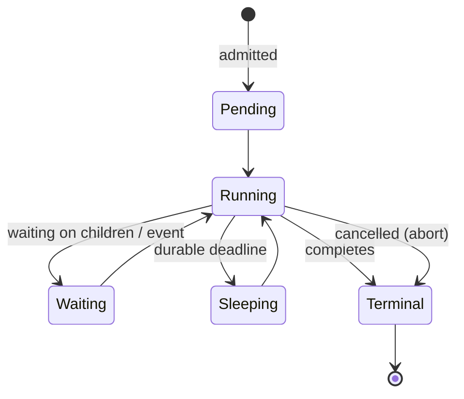

# Design: architect-declared member configuration, lifecycle and trust boundaries

**Status:** design only — no runtime code exists for anything described here.
**Issue:** #223 (spike), parent #222 (planning only).
**Numbering:** this document is separate from [`DESIGN.md`](DESIGN.md). Its own sections are
`§A1`–`§A9` so they cannot be confused with `DESIGN.md`'s `§3.x` series; references into the
existing design are written as `DESIGN.md §3.13` and so on.

## A1. What this document is, and what it is not

A reviewable design for a **versioned, declarative client-architect configuration** that sits
above the agent-definition surface the durable layer already has. A client architect writes one
document per member: identity, role, capabilities, ownership, lifecycle, schedules and workflow
stages. A host reads it, validates it, compiles it down to the types that already exist, and
drives it.

The three properties the design is built around:

1. **It is a layer, not a fork.** Every field the configuration declares resolves to a type that
   already exists and already has tests: `AgentDefinition`, `AgentChoices`, `DurableSchedule`,
   `DurableTaskDefinition`. Nothing in the execution path is new.
2. **It is data, never authority.** A declared configuration — and any content retrieved because
   of it — cannot widen what the host permits. The permission handler stays the authority, and
   it is fail-closed.
3. **It is durable before it is acted on.** Lifecycle transitions, claims and work are committed
   to the store before the effect they describe. A process that dies mid-transition leaves a
   readable state, not a half-applied one.

**This document is not an implementation plan for a feature that exists.** `lib/Durable.cs` has
no concept of a member, a role, an owner route, or a lifecycle. Verified by inspection: the only
matches for `Member`/`Lifecycle`/`Bench`/`Drain` in `lib/Durable.cs` are unrelated —
`TaskStatus`'s lifecycle doc comment (`lib/Durable.cs:168`), the harness's `_lifecycleGate`
(`lib/Durable.cs:4790`), and `DrainTasksAsync` (`lib/Durable.cs:6383`). There is no
`schemaVersion` anywhere in `lib/` or `src/`. §A2 states the reuse claim; §A8 states the
current-vs-missing inventory explicitly so no reader mistakes this design for delivered
capability.

### Why there is no test in this change

This is a `type:spike` issue. The change is documentation only: no runtime behaviour changes, so
there is no behaviour for a test to assert, and adding a test that asserts nothing new would be
noise. The acceptance evidence for a spike is the reviewable document plus reviewer sign-off,
and the follow-on implementation issue carries the behavioural tests. That is stated here rather
than left implicit because acceptance criterion 4 is a *review* gate, not an artifact the author
can produce (§A9).

## A2. Reused versus new components

The design adds two document kinds and one resolution step. Everything else is the existing
surface, unchanged.

| Component | Current location | Disposition |
|---|---|---|
| `AgentDefinition` | `lib/Durable.cs:3450` | **Reused as-is.** The architect configuration *compiles down* to this type. No field added, no field removed, no new document kind on it. |
| `AgentDefinition.ToChoices()` | `lib/Durable.cs:3504` | **Reused as-is.** Total conversion, already the single path from a definition to session choices. |
| `AgentChoices` | `lib/Durable.cs:3342` | **Reused as-is.** `Permissions` (`:3388`), `Sandbox` (`:3404`), `Hooks` (`:3411`, `[JsonIgnore]`) keep their meanings. |
| `ResolvedAgent` | `lib/Durable.cs:3415` | **Reused as-is.** The resolved record already carries grants, sandbox and hooks separately. |
| `AgentDefinitionValidator` | `src/Durable.Runtime/AgentDefinitionValidator.cs:24` | **Extended, not replaced.** `Validate` (`:35`) gains a call that validates the architect layer *before* compiling it to an `AgentDefinition`; the existing name/extension/tool/sandbox/permission rules (`:47`, `:56`, `:83`, `:111`, `:119`) run unchanged on the compiled result. |
| `ScheduleStore` | `src/Durable.Runtime/Scheduler.cs:10` | **Reused as-is.** `Definition` (`:13`), `Read` (`:17`), `Enabled` (`:28`), `SaveAsync` (`:36`) are untouched. The architect configuration *declares* schedules; a reconciler writes ordinary `DurableSchedule` records through `SaveAsync`. |
| `Scheduler` | `src/Durable.Runtime/Scheduler.cs:160` | **Reused as-is.** `PassAsync` (`:200`) keeps its claim-then-run order (`:211`, `:219`). |
| `DurableSchedule` | `lib/Durable.cs:3567` | **Reused as-is.** Kind `durable.schedule` (`:3570`), owner `schedule:{agent}` (`:3576`), `MissedRunPolicy` (`:3526`). |
| Durable document primitives | `DocumentDefinition<T>` (`lib/Durable.cs:51`), `DocumentHistory` (`:41`), `ForkPolicy` (`:28`), `Transaction.Doc` (`:2624`), `DocumentDraft.Save` (`:2747`) | **Reused as-is.** The two new documents are ordinary documents; no new persistence primitive. |
| `DurableStore.CommitAsync` | `lib/Durable.cs:2119` | **Reused as-is.** The commit gate (`_gate`, `lib/Durable.cs:1788`) is the serialization point for every transition. Not weakened, not bypassed. |
| `DurableTaskDefinition` / `DurableTaskRecord` / `TaskStatus` | `lib/Durable.cs:406`, `:188`, `:169` | **Reused as-is.** A declared workflow stage compiles to a phase (`:428`); a run's state is the existing task record. |
| `InputAdmission` + `AdmitAsync`/`SettleAsync` | `lib/Durable.cs:625`, `:4245`, `:4266` | **Reused as a pattern.** A transition commits intent, performs the effect, then settles — the same three-step shape already used for prompt admission. |
| Host permission handler | `lib/Durable.cs:6191` (`config.OnPermissionRequest = Options.PermissionHandler ?? PermissionPolicy.Handler(...)`), options at `:4658`, policy at `:2976` | **Reused as-is, and is the authority.** The configuration cannot reach this line. |
| `ContainmentClassifier` | `src/Durable.Runtime/Containment.cs:33` | **Reused as-is.** Its pessimistic classification (`:37`–`:47`) must keep reporting what the *host* enforces, not what the configuration claims. |
| **`durable.architect-config`** | — | **New document kind**, owner `architect:{name}`. Declarative, versioned, rewindable, `ForkPolicy.Initial`. |
| **`durable.member-state`** | — | **New document kind**, owner `member:{name}`. Mutable lifecycle state, rewindable, `ForkPolicy.Initial`. |
| **Architect config validator** | — | **New**, called from `AgentDefinitionValidator.Validate` before compilation. Name shape, schema version, reference resolution, ownership-cycle check. |
| **Config → `AgentDefinition` compiler** | — | **New**, pure function. The only new code that produces an existing type. |
| **Schedule reconciler** | — | **New, small.** Compiles the config's `schedules[]` into `DurableSchedule` records via `ScheduleStore.SaveAsync`. |
| **Claim/transition function** | — | **New.** Read-validate-write inside one `CommitAsync`, modelled on `SettleAsync` (`lib/Durable.cs:4266`). |

Two document kinds, not one, because they answer different questions and change at different
rates. `architect:{name}` is *what the architect declared* — reviewed, versioned, rarely
rewritten. `member:{name}` is *what happened to the member* — claimed, paused, drained, replaced.
Folding them together would mean every lifecycle transition commits a new version of the
declaration, and "what was declared" would stop being answerable from the store.
`DESIGN.md §3.13` makes the same split for schedules and occurrences.

Both are declared `ForkPolicy.Initial` for the reason `durable.schedule` is: a forked conversation
must not inherit a second copy of a team member. Forking a conversation is not hiring.

## A3. Configuration schema and version rules

### A3.1 Top-level shape

Illustrative only — the field set is what the design commits to, not a final schema:

```jsonc
{
  "schemaVersion": 1,
  "name": "core-engineer",              // member identity; matches the existing name pattern
  "role": "Core Engineer",              // human label, no authority
  "description": "...",
  "ownership": {                        // owner routes; validated acyclic
    "owns": ["lib/Durable.cs", "src/Durable.Runtime"],
    "reportsTo": "lead"
  },
  "capabilities": {                     // compiles 1:1 onto AgentDefinition
    "extensions": ["core"],
    "tools": ["read_file", "write_file"],
    "permissions": ["read:/workspace", "write:/workspace"],   // grants, not authority
    "sandbox": { "enabled": true, "filesystem": { ... } },
    "model": "...",
    "instructions": "..."
  },
  "lifecycle": {
    "maxConcurrent": 1,                 // policy the host enforces; cannot exceed the store's bound
    "drainTimeout": "10m"
  },
  "schedules": [
    { "every": "1d", "missedRun": "skip" }
  ],
  "workflow": {
    "stages": [
      { "name": "implement", "next": "review" },
      { "name": "review",   "next": null }
    ]
  }
}
```

### A3.2 `schemaVersion` gates migration

`schemaVersion` is **required and has no default**. The versioning rules:

| Situation | Behaviour |
|---|---|
| `schemaVersion` absent | **Refuse.** Validation error naming the version the host supports. A document with no version is not a v1 document; it is a document of unknown shape. |
| `schemaVersion` == host's version | Read normally. |
| `schemaVersion` < host's version | Run the registered migration chain, oldest first, one step per version. Each step is a pure function over the JSON. |
| `schemaVersion` > host's version | **Refuse, fail closed.** The message names both the document's version and the host's maximum. The host does not guess at fields it does not know and does not apply a partial configuration. |
| `schemaVersion` not an integer | **Refuse.** No coercion from string or float. |

A migration step is **forward-only and explicit**. There is no downgrade path, because a
downgrade cannot be honest: a v2 field that v1 has no home for has to be dropped, and dropping a
declared field silently is exactly the failure mode the store exists to prevent. An older host
meeting a newer document refuses; the operator upgrades the host or the document.

Migration writes a new version rather than rewriting history. The store is append-only and every
committed version stays readable as of its entry (`DocumentState.Versions`, `lib/Durable.cs:110`;
`AsOf`, `:116`), so a migration commits `{ schemaVersion: N+1, migratedFrom: N, ... }` as a new
version in the same transaction as whatever change triggered the read. An audit after the fact
can see what the document said before it was migrated.

### A3.3 What validation adds

`AgentDefinitionValidator.Validate` (`src/Durable.Runtime/AgentDefinitionValidator.cs:35`) keeps
its current five checks and gains a prior step. Order matters: the architect layer is validated
first, because compiling an invalid layer produces an `AgentDefinition` whose failures point at
the wrong document.

New checks:

- **Schema version** per §A3.2.
- **Name shape** — reuse `NamePattern` (`:27`) rather than a second regex.
- **Reference resolution** — every extension and tool named in `capabilities` must resolve in
  the registry. This is the existing `ValidateExtensions`/`ValidateTools` behaviour (`:56`,
  `:83`), reached through the compiled `AgentDefinition`, so it is not re-implemented.
- **Ownership acyclicity** — `reportsTo` must not form a cycle. A cycle is a refusal, not a
  warning: an ownership graph with a cycle has no root, so no route exists for the work.
- **Stage graph well-formedness** — every `next` names a declared stage; no unreachable stage;
  at least one terminal stage.
- **Schedule syntax** — reuse the interval parser the `schedule` command already uses
  (`DESIGN.md §3.13`: `ms`/`s`/`m`/`h`, bare number as seconds) and `MissedRunPolicies.Parse`
  (`src/Durable.Runtime/Scheduler.cs:61`) rather than a second parser.

Validation runs at import, at host startup, and on every invocation — the same three points
`LoadDefinitionAsync` already validates at (`src/Durable.Runtime/Program.cs:1161`, `:1184`). A
definition that was valid at import and is not valid now is a refusal, not a silent narrowing.

## A4. Persistence

### A4.1 Documents and owner ids

| Document kind | Owner id | History | Fork | Why |
|---|---|---|---|---|
| `durable.architect-config` | `architect:{name}` | `Rewindable` | `Initial` | The declaration. Rewindable so an audit can read what the architect declared before a change; `Initial` so a conversation fork does not inherit a member. |
| `durable.member-state` | `member:{name}` | `Rewindable` | `Initial` | The lifecycle record. Rewindable because every transition is a fact worth keeping; `Initial` for the same fork reason. |
| `durable.agent-definition` | `agent:{name}` | `Rewindable` | `Initial` | **Unchanged.** Still the compiled, executable definition (`lib/Durable.cs:3453`, `:3459`). |
| `durable.schedule` | `schedule:{agent}` | `Rewindable` | `Initial` | **Unchanged.** Still the only thing the scheduler reads (`src/Durable.Runtime/Scheduler.cs:17`). |
| task record (**not** a document) | `t{n}` (`DurableTaskRecord.Id`, `lib/Durable.cs:188`, `:201`) | — | — | **Unchanged.** In-flight work is an ordinary task record, added through `CreateTask` (`lib/Durable.cs:2646`). |

The owner prefixes follow the existing disjointness argument (`lib/Durable.cs:3438`–`:3441`):
`architect:` and `member:` are new namespaces, disjoint from `c{n}`, `t{n}`, `e{n}`, `a{Guid}`,
`agent:{name}` and `schedule:{agent}`. No existing owner id changes meaning.

`agent:{name}` stays the *compiled* definition rather than being replaced by
`architect:{name}`, because two readers already depend on it: the runtime's
`LoadDefinitionAsync` (`src/Durable.Runtime/Program.cs:1173`) and `UnknownAgentMessage`'s
listing (`:1218`). Compilation writes an `agent:{name}` version through the existing
`SaveDefinitionAsync` path (`:1206`) — so an architect config change is visible to every existing
reader as an ordinary definition change, with no reader modified.

### A4.2 Mapping declaration to durable state

```
durable.architect-config  (architect:{name})        ← the architect writes this
        │
        │  validate (§A3.3), then compile
        ▼
   AgentDefinition        (agent:{name})             ← existing type, existing document kind
        │
        ├── ToChoices()  (lib/Durable.cs:3504)
        │        ▼
        │   AgentChoices  ──► BuildSessionConfig (lib/Durable.cs:6164)
        │                          └── config.OnPermissionRequest (lib/Durable.cs:6191)  ← the authority
        │
        ├── schedules[]  ──► DurableSchedule (schedule:{agent})   ← reconciler, existing SaveAsync
        │                          └── Scheduler.PassAsync (src/Durable.Runtime/Scheduler.cs:200)
        │
        └── workflow.stages[] ──► DurableTaskDefinition.Phases (lib/Durable.cs:428)
                                   └── DurableTaskRecord / TaskStatus (lib/Durable.cs:188, :169)

durable.member-state  (member:{name})               ← every transition writes a version here
```

Three consequences worth stating plainly:

- **The scheduler needs no change.** `Scheduler.PassAsync` reads `ScheduleStore.Enabled`
  (`src/Durable.Runtime/Scheduler.cs:195`), which reads `durable.schedule` documents. The
  configuration is not a schedule; it is reconciled into schedules. A member whose config has no
  `schedules[]` gets no schedule records, and the scheduler drives nothing for it — the same
  behaviour as a store with no schedule.
- **Workflow stages are not new persistence.** A stage is a phase of a
  `DurableTaskDefinition` (`lib/Durable.cs:428`), and a run is a `DurableTaskRecord`
  (`lib/Durable.cs:188`) whose state is the existing `TaskStatus` (`:169`). No stage store.
- **In-flight work is a task id.** Member state records task ids (`t{n}`) it admitted. It does
  not copy them. A task's own record is its truth.

### A4.3 Cross-language wire-format impact

**This design requires no change to the store envelope and no change to any existing record.**
Both new documents are ordinary document records inside the existing JSONL envelope:
`JsonlRecord(long V, long Seq, string Type, JsonElement Payload)` (`lib/Durable.cs:1759`), with
documents described by `JsonlDocumentRef` (`:1767`) and `JsonlDocumentVersion` (`:1770`). A new
*kind* is a string inside an existing record type. `V` stays `1`.

Evidence for the additive claim: the TypeScript and Python ports already do not define
`durable.agent-definition` or `durable.schedule` — they define `durable.agent`
(`lib/ts/durable.ts:3007`, `lib/py/durable.py:3109`). Those two kinds are already
C#-runtime-only documents that the ports ignore, and the store still round-trips across all
three. Two more kinds in the same position is the same situation.

Two constraints follow, and they are constraints on *future* work, not on this design:

1. **A reader must ignore unknown kinds, not fail on them.** This is already how the ports
   behave for `durable.agent-definition`. A future port that validates kinds against a known set
   would break on every newer C# store; that is a defect in the port, not a licence to keep the
   kind list frozen.
2. **Nothing may compact the store by filtering to known kinds.** The JSONL provider appends
   (`lib/Durable.cs:1506`); `_replaceOnCommit` is set only for the one-time legacy-snapshot
   conversion (`:1756`), not for ordinary commits. A compaction that kept only known kinds would
   silently delete another implementation's documents. This design does not add one, and any
   future compaction must preserve unknown records verbatim.

**If a future revision does need a new envelope record type** — not a new kind — that is a store
format change. It needs a migration note and evidence that an existing store still reads, per the
repository's standing rule for the shared wire format. This design deliberately avoids that
requirement by adding kinds only.

## A5. Lifecycle state machine

### A5.1 States

Five states, no more. "Not yet hired" is the absence of a `member:{name}` document, not a state,
because a state that has no record cannot be transitioned from.

| State | Means | New work admitted? | In-flight work |
|---|---|---|---|
| `benched` | Hired, declared, not scheduled. The initial state. | No | None expected |
| `active` | Holding the shift; schedules drive it. | Yes | Runs |
| `paused` | Held out of the rotation temporarily. | No | Left to finish; not drained |
| `draining` | Held out of the rotation and finishing what it holds. | No | Must reach zero |
| `replaced` | Superseded by a successor. Terminal. | No | Must be zero or handed off |

`benched` as the initial state is deliberate: hiring commits a declaration and a state record,
and activation is a separate, explicit transition. A hire that immediately runs work is a hire
nobody reviewed.

### A5.2 Member lifecycle

```mermaid
stateDiagram-v2
    [*] --> Benched: hire — config + state committed together
    Benched --> Active: activate (claim)
    Active --> Paused: pause (stop admitting; in-flight continues)
    Paused --> Active: resume (claim)
    Active --> Draining: drain (stop admitting; wait for in-flight)
    Paused --> Draining: drain
    Draining --> Benched: drain complete (in-flight is empty)
    Draining --> Paused: drain abandoned (timeout; work still in flight)
    Benched --> Replaced: replace (successor committed)
    Active --> Replaced: replace
    Paused --> Replaced: replace
    Draining --> Replaced: replace
    Replaced --> [*]: terminal; handoff pointer remains readable
```

`pause` and `drain` differ in exactly one observable way: `paused` does not wait, `draining`
does. That is the same distinction `DESIGN.md §3.13` draws between `skip` and `coalesce` — same
landing, different thing done on the way.

`drain → paused` on timeout is deliberate rather than convenient. A drain that cannot finish must
not be reported as finished. The member lands in `paused` with the outstanding work listed, which
is a truthful "not draining any more, and here is what is still running" — not a claim of a clean
drain that did not happen.

### A5.3 In-flight work, and what "cancel" is not



This is the existing `TaskStatus` machine (`lib/Durable.cs:169`) and the existing
`TaskCommit.Aborted()` outcome (`:326`) reached through `AbortTaskAsync`
(`lib/Durable.cs:6666`). The design adds nothing to it.

**Cancel is an operation on one work item, not a member state.** Cancelling work aborts a task
and records a terminal outcome; the member's state is unchanged. Draining is a member state that
*waits* for its work. Conflating them is the mistake this section exists to prevent: a member
that cancelled one task is not a member that stopped working, and a member that is draining has
not necessarily cancelled anything.

### A5.4 Every transition is a durable commit

A transition is one `CommitAsync` (`lib/Durable.cs:2119`) that, in a single transaction:

1. reads the current `member:{name}` version,
2. validates the transition and the expected epoch (§A6.2),
3. writes the new state version,
4. appends an entry anchored to the member's owner id — the same shape as
   `SaveDefinitionAsync`'s `tx.AppendEntry(ownerId, "agent-definition")`
   (`src/Durable.Runtime/Program.cs:1213`) and `ScheduleStore.SaveAsync`'s
   `transaction.AppendEntry(ownerId, "schedule")` (`src/Durable.Runtime/Scheduler.cs:43`).

Everything inside is saved together or discarded together: `_provider.Commit()` on success,
`_provider.Rollback()` on throw (`lib/Durable.cs:2135`, `:2139`).

**What is left behind if the process dies mid-transition.** There is no half-transition, because
the store commits atomically — but the *effect* a transition describes may live outside the store
(aborting a task, telling a scheduler to stop). Those cannot be atomic with the commit, so the
design uses the admission pattern the durable layer already applies to sends
(`lib/Durable.cs:4245` commits the intent, `:4266` records the outcome):

- `draining` commits **intent first**: state `draining`, plus the task ids it is waiting for.
  Then the host stops admitting and waits.
- A crash after that commit leaves a member in `draining` with a committed intent entry and work
  that may still be running. A restarted host reads the member state, re-reads each listed task
  record, and either finishes the drain or reports `draining` with the outstanding ids. It does
  **not** re-run anything and does **not** flip the state on the operator's behalf.
- `replaced` commits the successor and the handoff pointer in the same transaction as the
  predecessor's terminal state, so there is never a moment where the successor exists and the
  predecessor is still `active`.

The honest limit: a transition whose external effect already happened and whose settle commit
never landed is indistinguishable from one whose effect never happened. That is exactly why
`InputAdmission` has an `uncertain` state (`lib/Durable.cs:625`, `:4479`) rather than a
best-guess replay, and why the member record carries the same "reconcile, never replay
automatically" rule.

## A6. Concurrency and the duplicate-safe claim

### A6.1 Admission and the existing bound

The durable layer already bounds concurrency, and the configuration cannot raise it:

- **One task runner per store.** `DurableStore.ClaimTaskScheduler` (`lib/Durable.cs:2490`)
  refuses a second runtime over the same store — "A store has one task runner, so share the
  runtime instead of opening a second one over the same store" (`:2497`).
- **One writer per store file.** A persistent store holds an exclusive sidecar lock
  (`lib/Durable.cs:1228`–`:1273`, `FileShare.None` at `:1266`) for its lifetime, so a second
  process is refused at open rather than interleaving appends (`DESIGN.md §3.1`, "Concurrency
  contract").
- **Scheduled occurrences are serial.** `Scheduler.PassAsync` iterates schedules and awaits each
  run before the next (`src/Durable.Runtime/Scheduler.cs:204`–`:220`).

So `lifecycle.maxConcurrent` in the configuration is a **policy number the host loop enforces,
and it can only lower the effective concurrency.** A configuration that asks for more than the
runtime already permits does not get it; the design has no mechanism to grant it, and adding one
would weaken the single-runner guarantee. This is stated in the schema comment and must be stated
in the validator's error text when the number is out of range.

### A6.2 The duplicate-safe claim rule

Two claimants must produce exactly one winner and one clean refusal — never two winners, never a
lost claim.

The rule is a **monotonic claim epoch**, validated inside the transaction:

- `member:{name}` carries `epoch` (integer) and `claimedBy` (host instance id).
- A claim or transition reads the current state **inside** `CommitAsync`'s body. `Transaction.Doc`
  (`lib/Durable.cs:2624`) reads the latest version, and the whole body runs under the store's
  `_gate` (`lib/Durable.cs:1788`, held for the duration of `CommitAsync`), so the read and the
  write cannot interleave with another transaction in the same process.
- The caller passes the `epoch` it believes it holds. The transition refuses if the stored
  `epoch` differs. On success it writes `epoch + 1`.

This is not a new mechanism. It is the shape `SettleAsync` already uses to refuse a stale
settlement: it reads the current admission inside the transaction and returns without writing if
`current.AdmissionId != admissionId` (`lib/Durable.cs:4266`–`:4285`). The claim rule is that
pattern with a counter instead of an id.

**Two claimants, one store file:** the file lock already excludes the second process; the second
never reaches the epoch check.
**Two claimants, one process, one store:** the `_gate` serializes them; the first increments the
epoch, the second's expected epoch is stale, and it is refused with a message telling it to
re-read. Refusal is not an error condition to retry blindly — it means someone else holds the
shift.
**Two claimants, an ephemeral store:** only the process-local `_gate` applies, because there is
no file. The epoch rule still produces one winner within that process. Across processes there is
nothing to protect, because an ephemeral store is not shared. This is a real limit and is stated
rather than papered over.

**What the claim does not do:** it does not take a lock for the duration of a shift. Holding a
long-lived lock would reintroduce the stale-lock problem the file lock solves by dying with the
process. The epoch is checked at each transition, so a claimant that dies simply stops
transitioning; the next claimant reads the last committed epoch and continues from there.

### A6.3 What this must not weaken

Restating the guarantees the design is not allowed to trade away:

- The commit gate stays non-reentrant and stays held for the whole transaction body
  (`lib/Durable.cs:2119`–`:2146`). A transition never calls `TaskRuntime.MemoAsync` from inside a
  commit callback — the hang documented at `lib/Durable.cs:2676`–`:2680` applies unchanged.
- Rollback still restores entries, documents and task state together (`lib/Durable.cs:2135`).
- The exclusive file lock is not relaxed to allow a second writer, even for "read-only"
  reconciliation.
- A schedule occurrence is still claimed durably before it runs
  (`src/Durable.Runtime/Scheduler.cs:211` then `:219`), so a crash loses an occurrence rather
  than repeating it.

## A7. Trust boundaries

### A7.1 The invariant

**Declared configuration and retrieved content are never authority.** Not the architect's
configuration document, not a skill's text, not an MCP server's tool descriptions, not a prompt
fragment pulled from a repository, a URL or a model. All of it is data that can influence what the
model *attempts*. None of it can influence what the host *permits*.

The authority is one line: `config.OnPermissionRequest = Options.PermissionHandler ??
PermissionPolicy.Handler(resolved.Permissions)` (`lib/Durable.cs:6191`). Either the host supplies
a handler (`DurableHarnessOptions.PermissionHandler`, `lib/Durable.cs:4658`) or the durable
fail-closed policy decides (`PermissionPolicy.Handler`, `:3027` → `IsGranted`, `:2997`). Nothing
in the configuration reaches that line.

Two corollaries the design depends on:

- **`Permissions` is a grant list, not a capability list.** A grant says what a request of that
  kind and scope may be approved. It does not say a tool exists, and it cannot create one.
- **The store is not an authority either.** Persisting a grant makes it *reproducible*, not
  *safe*; `DESIGN.md §3.1` ("Permissions") makes that distinction already, and this design does
  not change it.

### A7.2 Surfaces

| Surface | Who declares it | What it can influence | What it must never be able to do | Where the host check sits |
|---|---|---|---|---|
| **Tool list** (`capabilities.tools`, `extensions`) | Architect config | Which tools the model is offered; which tool names must resolve | Grant a tool the session was not granted; make an unresolvable tool appear | `ValidateTools` (`src/Durable.Runtime/AgentDefinitionValidator.cs:83`) refuses an unknown name at import and startup; `config.OnPermissionRequest` (`lib/Durable.cs:6191`) decides each call |
| **Permission grants** (`capabilities.permissions`) | Architect config | Which requests the fail-closed policy will approve | Bypass the handler; approve something not written down; widen at runtime | `PermissionPolicy.IsGranted` (`lib/Durable.cs:2997`) against `PermissionGrant` (`:2944`); wildcard scope still goes through `ScopeMatches` (`:3046`) |
| **Sandbox policy** (`capabilities.sandbox`) | Architect config | Whether the session runs sandboxed and with what filesystem/network shape | Disable the host's sandbox; widen the host's policy | `DurableSandboxPolicy` (`lib/Durable.cs:3084`) validated by `ValidateSandboxPolicy` (`:6013`), called from `ValidateSandbox` (`AgentDefinitionValidator.cs:111`); applied at session build (`:6199`) |
| **Prompt sections and instructions** | Architect config, extensions, retrieved skill text | The text the model reads, including declared instructions and any retrieved fragment | Grant a capability; change the permission handler; become an instruction the host obeys | It is prompt text. It reaches the model, and the model's tool calls still hit `:6191`. `PromptSection` (`lib/Durable.cs:2860`) renders text; it holds no authority |
| **Retrieved content** (skills, MCP tool descriptions, remote docs) | Anywhere | The same prompt channel as instructions | Anything beyond the prompt channel | Same as above. It is never parsed as configuration and never merged into `AgentDefinition` |
| **MCP servers** (`capabilities`, declared server list) | Architect config | Which servers are discoverable and which `server/tool` pairs can be requested | Authorize an MCP call | `PermissionPolicy.Describe` maps an MCP request to `("mcp", "server/tool")` (`lib/Durable.cs:2986`); the grant decides |
| **Hooks** | **Not declarable today.** `AgentChoices.Hooks` is `[JsonIgnore]` (`lib/Durable.cs:3410`), so no stored document can install one | — | Install host code from a persisted document | `DurableHarnessOptions.EnableFileHooks` (`:4681`) is host configuration, not durable state; hooks run inside the sandbox (`:4665`–`:4674`) so an ungranted hook is denied; a hook permission request is `("hook", toolName)` (`:2987`) |
| **Schedules** | Architect config (`schedules[]`), reconciled into `DurableSchedule` | When a run happens, and the missed-run policy | Widen the authority of the run it triggers | `Scheduler.PassAsync` → `_run` (`src/Durable.Runtime/Scheduler.cs:219`) → the same `RunTurnAsync`/`ExecuteTurnAsync` (`src/Durable.Runtime/Program.cs:351`, `:388`) → the same `BuildSessionConfig` (`lib/Durable.cs:6164`) → the same handler (`:6191`) |
| **Workflow stages** | Architect config (`workflow.stages[]`) | The order work passes through; which phases run | Grant a stage capability; skip the permission handler inside a stage | A stage is a phase (`DurableTaskDefinition.Phases`, `lib/Durable.cs:428`) running host code; its tool calls go through the session's handler like any other |
| **Lifecycle and ownership** | Architect config | Who holds a shift; who is paused; who is replaced | Grant authority to a member; change what the host enforces | `ContainmentClassifier.Classify` (`src/Durable.Runtime/Containment.cs:33`) reports what the **host** enforces, and is deliberately pessimistic about a host-supplied handler (`:42`–`:44`) |

### A7.3 What the table is protecting against

The failure mode is not "the model reads a bad instruction". It is "the system treats a bad
instruction as a permission". Three shapes of that failure, and why each is closed:

- **A retrieved skill that says "you may write anywhere".** It is prompt text. The write is a
  `PermissionRequestWrite` (`lib/Durable.cs:2983`) described as `("write", path)` and matched
  against grants by `IsGranted` (`:2997`). If the grant set does not cover it, the decision is
  `PermissionDecisionReject` with a feedback string (`:3038`). The text changed what was
  attempted; it did not change the answer.
- **A declared MCP server whose tool description instructs the model to escalate.** Same
  channel. The MCP call is gated as `("mcp", "server/tool")` (`:2986`). Declaring the server made
  it discoverable, not authorized.
- **A configuration that declares a hook.** Cannot happen through the store: hooks are
  `[JsonIgnore]` (`:3410`) and never persisted. If a later revision makes hooks declarable, the
  hook must become a permission request (`("hook", toolName)`, `:2987`) checked by the same
  handler — not a code path the configuration can add.

One thing this design explicitly does **not** claim: that prompt instructions are enforcement.
The parent issue says so ("No guarantee that model instructions alone enforce security"), and the
repository already agrees — `DESIGN.md §3.1` treats a persisted grant as reproducibility, and
`Containment` (`src/Durable.Runtime/Containment.cs:22`) reports `None` when a host handler takes
over, because the durable layer genuinely enforces nothing in that case.

### A7.4 Linked capabilities as implemented by #226

The design's §A7.2 table is the contract; #226 implements the link layer that feeds it. The
implementation is in `lib/Durable.cs` and the host's validator, and it changes no authority line:

- **A link is a name and a version, not a copy.** `DurableLink` carries `Kind` (`skill`, `mcp`,
  `tool`), `Name`, optional `Version`, a `Mode` (`prompt` or `tools`), and optional `Grants`.
  `DurableLinks.Resolve` resolves it against the host's `ExtensionRegistry` and
  `DurableMcpServerRegistry`. A missing link refuses with the installed names in the message; a
  version mismatch refuses with both versions; an unversioned host refuses a versioned link.
- **A link's grants are a request, never an authority.** `DurableLinks.Resolve` checks each
  requested grant against the definition's own `Permissions` with `PermissionPolicy.IsGranted`.
  A request the member does not already hold is refused; nothing is merged into the definition's
  grants. An MCP server's own manifest grants are recorded on the resolved server but never
  applied.
- **Discoverability is not authorization.** A resolved link contributes extension and tool names
  to the compiled `AgentChoices`, so the model is offered them. The permission handler at
  `lib/Durable.cs:6191` still decides each call; a linked tool the member did not grant is
  offered and denied.
- **Portable configuration carries no secrets.** `DurablePortableConfiguration.Export` writes
  only the portable fields and refuses to emit a document containing a secret-shaped value
  (key name or value). Credentials stay in the host's environment or credential store and are
  referenced by name. `Import` validates `schemaVersion` and resolves the links, so a retrieved
  configuration cannot widen authority at import either.
- **The host refuses at import and startup.** `AgentDefinitionValidator.Validate` calls
  `DurableLinks.Resolve` when `Links` is present, so a definition with a missing or incompatible
  link fails closed before a turn runs. An existing definition without `links` reads and runs
  unchanged.

One registry, two readers. Validation and resolution both receive the host's single
`DurableMcpServerRegistry`, built once in `Program.cs`. The host has no configuration surface for
an MCP server yet, so that registry is empty today and the two readers cannot disagree. When a
surface is added, populate the one registry rather than threading a separate list through
validation: a definition must be validated against the same servers it will resolve against, or a
link can validate and then fail to resolve.

This closes Q5's *mechanism* (secrets live outside the document; the exporter refuses to emit
them) without choosing a credential store, which remains the user's decision. Q2, Q7 and Q12 are
unaffected.

## A8. Current configuration versus missing capability

This section exists because the parent issue requires the distinction, and because a design
document about team configuration is easy to misread as a description of the team that already
exists.

### A8.1 Configuration already applied to this repository

`.squad/` is a real, working team configuration. It is also **Markdown and JSON edited by hand**,
with none of the properties this design describes:

| Artifact | What it holds today | What it lacks |
|---|---|---|
| `.squad/team.md` | The roster: name, role, charter path, status (`🏗️ Active`, `📋 Silent`, `🔄 Monitor`) | Status is a string a human edits. There is no state machine, no transition record, no claim, no epoch. |
| `.squad/routing.md` | Work-type → owner routing table; issue-label routing | No schema, no version, no validation, no acyclicity check. A cycle would simply never resolve. |
| `.squad/agents/{member}/charter.md` | Prose charter per member | Not machine-readable, so nothing can validate it or compile it to a session. |
| `.squad/canvas-policy.md` | Ownership, refresh and handoff policy | Prose. Enforcement is a prompt convention, not a runtime check. |
| `.squad/decisions.md` | Accepted decisions | Append-only by convention, not by the store. |
| `.squad/config.json` | Team config | Not versioned; no `schemaVersion`. |

The honest summary: this repository's team is **configured by convention**, and the conventions
are load-bearing because people and prompts follow them. Nothing enforces them.

### A8.2 Capability this design describes and the product does not have

None of the following exists in `lib/` or `src/` today:

- No member, role, ownership or routing type. `AgentDefinition` (`lib/Durable.cs:3450`) is a
  *capability* declaration — extensions, tools, model, permissions, sandbox. It has no role, no
  owner, no lifecycle.
- No lifecycle state. `TaskStatus` (`lib/Durable.cs:169`) is task lifecycle, not member
  lifecycle.
- No `schemaVersion` on any persisted type. Verified: the only `schemaVersion` in the repository
  is the parity manifest's, described at `DESIGN.md:939`, which is unrelated.
- No claim or epoch. The closest existing mechanism is `ClaimTaskScheduler`
  (`lib/Durable.cs:2490`), which claims a *store-wide slot*, not a member's shift, and the
  admission id check in `SettleAsync` (`:4266`), which is a per-admission guard.
- No duplicate-safe member ownership, no drain, no replacement, no handoff pointer.
- No declarative workflow stages. `DurableTaskDefinition` (`lib/Durable.cs:406`) exists and is
  written in code; nothing compiles a declared stage list into it.

The `squad watch --execute --max-concurrent 2` invocation noted in the Lead charter is **Squad's
own CLI**, a separate tool. Its availability is not evidence that this product has bounded
admission, safe claims, shared-resource serialization or reviewer limits. Those remain design
targets here, not delivered behaviour.

## A9. Open questions

Each names the role that must answer it. None is answered by this document.

| # | Question | Owner |
|---|---|---|
| Q1 | Is a `member:` record scoped to one store, or to a "client" that may span stores? Everything in §A4.1 assumes one store. | PO |
| Q2 | Does `replaced` transfer the predecessor's `schedule:{agent}` records to the successor, or leave them disabled with the predecessor? §A5.2 leaves them; the alternative is a reconciler rule that is not designed yet. | Core Engineer |
| Q3 | One `architect-config` document per member, or one per team with nested members? Per-member is assumed here because it keeps owner ids flat and matches `agent:{name}`. | Lead / Architect, PO |
| Q4 | Who may activate a benched member — any host that can open the store, or an explicitly named operator id in the config? Today the claim rule (§A6.2) accepts any claimant. | PO, user |
| Q5 | Where does secret material live? MCP credentials must not be in the config document (it is committed and rewindable). Parent #222 requires "secrets separation" but does not say where. | Core Engineer, user |
| Q6 | Do the review/evidence gates of parent #222 fit as workflow stages compiled to `DurableTaskDefinition.Phases`, or do they need their own durable record? §A4.2 assumes phases. | Core Engineer |
| Q7 | Does v1 ship with an empty migration chain, or with a v1→v2 stub to prove the mechanism? Shipping a stub that migrates nothing is untested code; shipping none means the first real migration is also the first test of the mechanism. | Lead / Architect |
| Q8 | Do the TypeScript and Python ports need to read `durable.architect-config`, or is it C#-runtime-only like `durable.agent-definition` and `durable.schedule` today? §A4.3 assumes the latter. | Polyglot Engineer |
| Q9 | Who writes `DurableSchedule` — the reconciler only, or may the existing `schedule` command still write one that the reconciler then disagrees with? A config that declares a schedule the operator also edits needs a precedence rule. | Core Engineer |
| Q10 | Should `permissions: ["*"]` be accepted? It is expressible today (`PermissionGrant`, `lib/Durable.cs:2944`; wildcard at `:3007`, `:3012`) and it makes `Containment` reporting meaningless. Accept with a warning, or refuse? | Lead / Architect, Rai |
| Q11 | Is `draining` allowed to be indefinite when `lifecycle.drainTimeout` is absent? §A5.2 assumes a default exists; no default is chosen here. | PO, Core Engineer |
| Q12 | Does an architect config change while a member is `active` take effect immediately, at the next occurrence, or require a transition? Immediate effect would change a running member's authority mid-shift. | Lead / Architect |

## A10. Reviewer sign-off

Acceptance criterion 4 is "Reviewed by PO and Core Engineer". That is a **review gate, not an
artifact**, and the author cannot satisfy it. It is recorded here as pending.

| Reviewer | Role | Scope of review | Status |
|---|---|---|---|
| PO | Product owner | §A1 scope, §A5 lifecycle semantics, §A8 current-vs-missing, §A9 Q1/Q4/Q11 | **Pending** |
| Core Engineer | `lib/Durable.cs` and `src/Durable.Runtime` owner | §A2 reuse claims, §A3 validation, §A4 persistence and wire format, §A6 concurrency | **Pending** |
| Tester | Acceptance evidence | Whether §A1's "no behavioural test" rationale is acceptable, and what the follow-on implementation issue must test | **Pending** |
| Rai | RAI reviewer | §A7 trust-boundary table, §A9 Q10 | **Pending** |
| Polyglot Engineer | Language ports | §A4.3 wire-format claim, §A9 Q8 | **Pending** |

Until PO and Core Engineer have actually reviewed, this design is a proposal. No part of it
authorizes implementation: parent #222 states that implementation needs Coordinator admission
within the two-implementation-issue limit.
